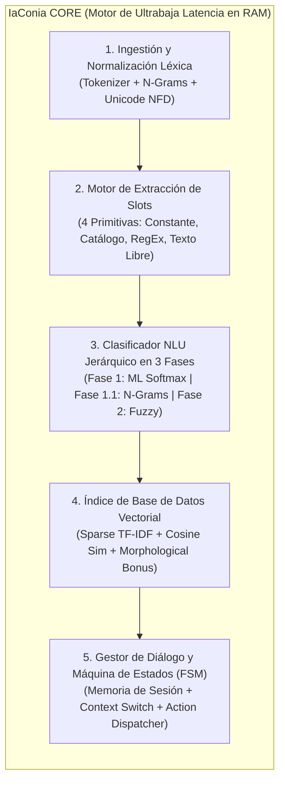
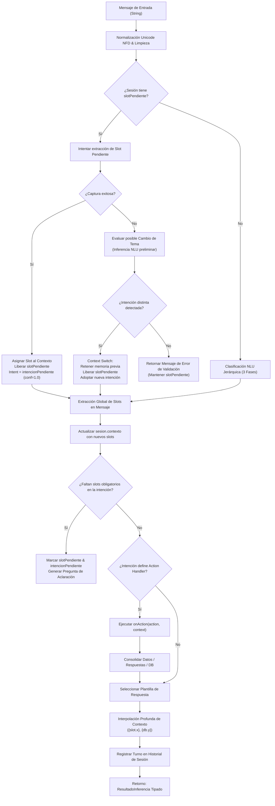
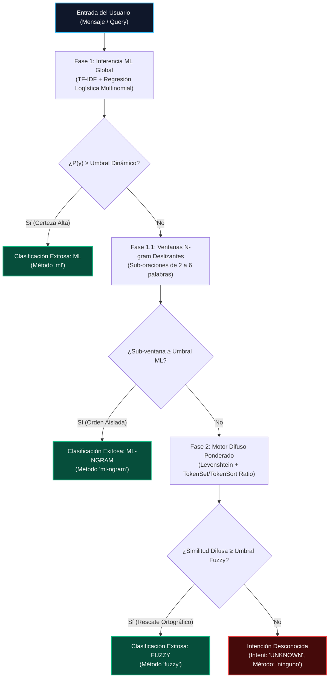
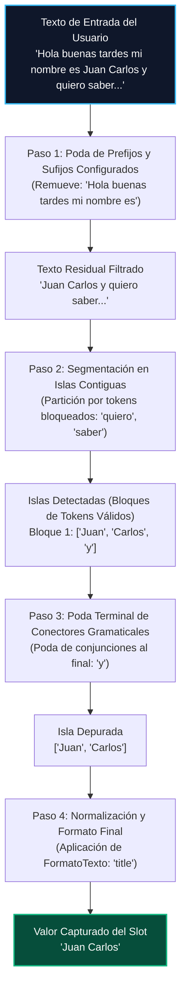
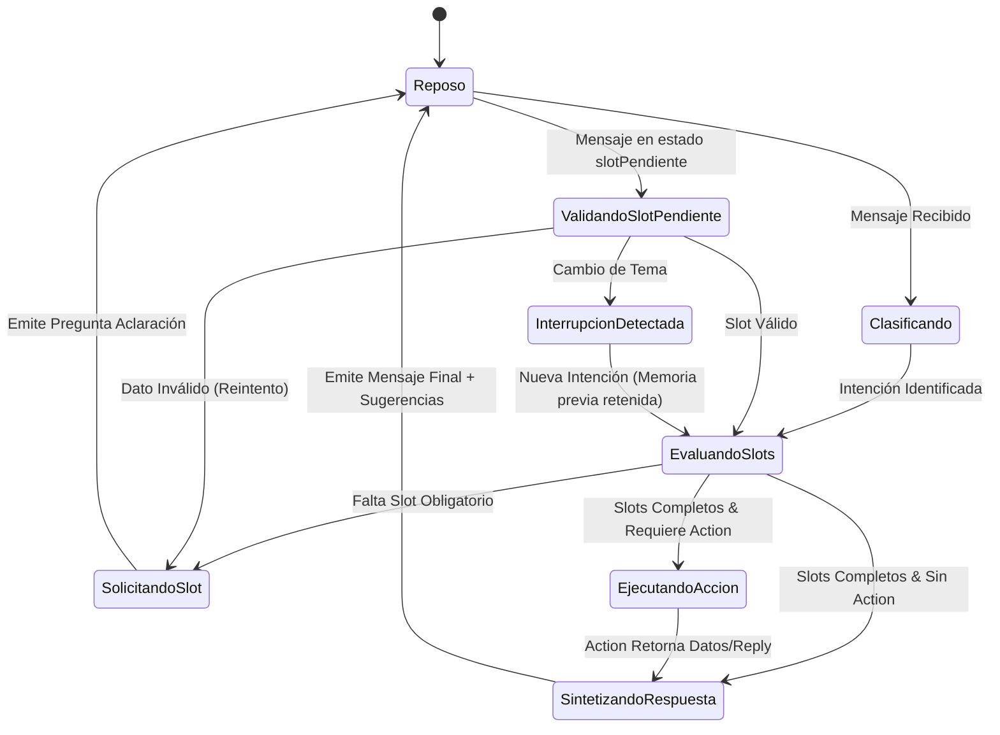

# 🧬 Documentación Técnica de Arquitectura y Algoritmos: Motor NLU `iaconia`

> **Documento de Especificación de Ingeniería y Diseño Matemático**  
> **Versión del Motor:** 3.0.0 (TypeScript & Python Dual Engine)  
> **Área:** Procesamiento de Lenguaje Natural en el Cliente / Edge NLU  
> **Licencia:** Propietaria / Confidencial  

---

## 📑 Tabla de Contenidos

1. [Visión General y Filosofía de Diseño](#1-visión-general-y-filosofía-de-diseño)
2. [Arquitectura Global del Sistema](#2-arquitectura-global-del-sistema)
   - [Diagrama de Pipeline de Ejecución](#diagrama-de-pipeline-de-ejecución)
   - [Estructura de Datos y Estado en Memoria](#estructura-de-datos-y-estado-en-memoria)
3. [Algoritmos de Extracción y Representación de Características (NLP)](#3-algoritmos-de-extracción-y-representación-de-características-nlp)
   - [Normalización Léxica y Lematización Dinámica](#normalización-léxica-y-lematización-dinámica)
   - [Vectorización TF-IDF con Frecuencia Sublineal](#vectorización-tf-idf-con-frecuencia-sublineal)
   - [Representación Dispersa en TypedArrays](#representación-dispersa-en-typedarrays)
4. [Algoritmo de Inferencia Jerárquica en 3 Fases](#4-algoritmo-de-inferencia-jerárquica-en-3-fases)
   - [Fase 1: Regresión Logística Multinomial (Softmax)](#fase-1-regresión-logística-multinomial-softmax)
   - [Fase 1.1: Ventanas Deslizantes Multiescala (N-gram Sliding Windows)](#fase-11-ventanas-deslizantes-multiescala-n-gram-sliding-windows)
   - [Fase 2: Motor Difuso Ponderado y Resiliencia Ortográfica](#fase-2-motor-difuso-ponderado-y-resiliencia-ortográfica)
5. [Extractor de Entidades y Variables (Slot Extraction Engine)](#5-extractor-de-entidades-y-variables-slot-extraction-engine)
   - [Las 4 Primitivas Algorítmicas](#las-4-primitivas-algorítmicas)
   - [Algoritmo de Islas Contiguas de Texto Libre](#algoritmo-de-islas-contiguas-de-texto-libre)
6. [Base de Datos Vectorial en Memoria (`VectorDatabaseIndex`)](#6-base-de-datos-vectorial-en-memoria-vectordatabaseindex)
   - [Aplanamiento Recursivo de Esquemas NoSQL](#aplanamiento-recursivo-de-esquemas-nosql)
   - [Similitud Coseno Dispersa con Ponderación Léxica](#similitud-coseno-dispersa-con-ponderación-léxica)
   - [Fallback de Cobertura de Tokens para Vocabulario Fuera de Distribución (OOV)](#fallback-de-cobertura-de-tokens-para-vocabulario-fuera-de-distribución-oov)
7. [Gestor de Diálogo y Máquina de Estados Finitos (FSM)](#7-gestor-de-diálogo-y-máquina-de-estados-finitos-fsm)
   - [Transiciones de Estado Conversacional](#transiciones-de-estado-conversacional)
   - [Manejo de Interrupciones y Cambio de Contexto con Memoria Retenida](#manejo-de-interrupciones-y-cambio-de-contexto-con-memoria-retenida)
   - [Interpolación Jerárquica de Plantillas](#interpolación-jerárquica-de-plantillas)
8. [Análisis de Complejidad Computacional y Benchmarks](#8-análisis-de-complejidad-computacional-y-benchmarks)
   - [Tabla de Complejidad Asintótica](#tabla-de-complejidad-asintótica)
   - [Perfiles de Rendimiento y Consumo de Memoria](#perfiles-de-rendimiento-y-consumo-de-memoria)
9. [Matriz Comparativa vs. Soluciones Tradicionales](#9-matriz-comparativa-vs-soluciones-tradicionales)

---

## 1. Visión General y Filosofía de Diseño

El motor **IaConia** es una implementación especializada de **Procesamiento de Lenguaje Natural (NLU) y Gestor de Diálogo (DM)** diseñada para operar bajo el paradigma **Client-Side / Edge-Native**.

A diferencia de las arquitecturas contemporáneas basadas en Modelos de Lenguaje Masivos (LLMs generativos como GPT-4, LLaMA o Claude) que operan como cajas negras estocásticas a través de APIs HTTP en la nube, IaConia resuelve el problema del lenguaje conversacional mediante un **enfoque determinista, híbrido (Machine Learning Lineal + Heurísticas Simbólicas) y de ultrabaja latencia**:

1. **Cero Dependencia de Red y Hardware Acelerado:** No requiere GPU, ni WebGPU, ni llamadas remotas; corre en cualquier runtime de JavaScript (V8, JavaScriptCore, Hermes, Bun, Node.js) o Python con cero dependencias externas de compilación C++.
2. **Baja Latencia en Turnos Cortos:** El tiempo promedio de inferencia, extracción de entidades y síntesis de respuesta suele quedar por debajo de **2 ms** en turnos cortos, en CPU monohilo. Los textos largos pueden tardar mucho más.
3. **Determinismo y Gobernabilidad:** El comportamiento no "alucina". Una entrada idéntica bajo el mismo estado conversacional produce exactamente el mismo resultado predecible.
4. **Huella de Memoria Ultraligera:** El binario empaquetado ocupa menos de **45 KB**, y un modelo con 50 intenciones y 500 frases consume menos de **1.8 MB de memoria RAM**.

---

## 2. Arquitectura Global del Sistema

El motor se organiza en 5 capas desacopladas que interactúan de forma sincrónica o micro-asincrónica en memoria RAM:

### Diagrama de Pipeline de Ejecución

El siguiente diagrama de flujo describe el ciclo de vida completo de un turno conversacional al invocar `bot.ask(mensaje, sessionId)`:

### Estructura de Datos y Estado en Memoria

Para garantizar cero asignaciones de memoria redundantes en el recolector de basura (GC), el estado se distribuye en estructuras nativas:

* **Vocabulario:** `Map<string, number>` con asignación de punteros enteros a posiciones vectoriales fijas.
* **Pesos y Vectores:** `Float32Array` contiguos en memoria, lo que permite aprovechar las optimizaciones SIMD de los compiladores JIT modernos.
* **Índices de Matriz Dispersa:** `Int32Array` y arrays densos de índices para calcular productos escalares únicamente sobre elementos distintos de cero (`nnz > 0`).

---

## 3. Algoritmos de Extracción y Representación de Características (NLP)

### Normalización Léxica y Lematización Dinámica

Todo texto procesado atraviesa una canalización de normalización determinista:

1. **Descomposición Canónica Unicode (NFD):** Se eliminan diacríticos y acentos sin alterar caracteres base mediante la expresión regular `[\u0300-\u036f]`.
2. **Filtrado Morfológico en Español:** Para búsqueda en catálogos y bases factuales, la función `normalizarRaizEs(palabra)` reduce flexiones de número y género:
   - Palabras terminadas en `-es` con longitud superior a 4 caracteres: corte de los 2 caracteres finales (ej. *"canciones"* $\rightarrow$ *"cancion"*).
   - Palabras terminadas en `-s` con longitud superior a 3 caracteres: corte del carácter final (ej. *"pedidos"* $\rightarrow$ *"pedido"*).

### Vectorización TF-IDF con Frecuencia Sublineal

A diferencia de las implementaciones ingenuas basadas en bolsa de palabras binaria (`Bag of Words`), IaConia implementa un vectorizador **TF-IDF (Term Frequency - Inverse Document Frequency)** con extracción de **unigramas y bigramas contiguos** y compresión sublineal.

#### 1. Extracción de N-Gramas
Para una secuencia de tokens limpios $(t_1, t_2, \dots, t_M)$, el espacio de términos $T$ contiene:

$$T = \{t_i \mid 1 \le i \le M\} \cup \{(t_i, t_{i+1}) \mid 1 \le i < M\}$$

Esto permite al modelo capturar semántica de polaridad y contexto inmediato sin recurrir a mecanismos de atención complejos (ej. *"no quiero"*, *"saldo actual"*).

#### 2. Frecuencia de Término Sublineal (Sublinear TF)
Para mitigar el sesgo introducido por palabras que se repiten múltiples veces en una misma frase de entrenamiento, se aplica una escala logarítmica:

$$\text{tf}_{\text{sub}}(t, d) = \begin{cases} 1 + \ln(\text{count}(t, d)) & \text{si } \text{count}(t, d) > 0 \\ 0 & \text{en otro caso} \end{cases}$$

#### 3. Frecuencia Inversa de Documento Suavizada (Smooth IDF)
Alineado con el estándar de scikit-learn, el factor IDF amortigua términos ubicuos en el corpus:

$$\text{idf}(t) = \ln\left(\frac{1 + N}{1 + \text{df}(t)}\right) + 1.0$$

Donde $N$ es el total de documentos/frases de entrenamiento y $\text{df}(t)$ es el número de documentos que contienen el término $t$.

#### 4. Normalización Euclidiana $L_2$
El vector final se proyecta sobre la hiperesfera unitaria de dimensión $V$ ($|V| = \text{tamaño del vocabulario}$):

$$\mathbf{v}_{\text{norm}} = \frac{\mathbf{v}}{\|\mathbf{v}\|_2} = \frac{\mathbf{v}}{\sqrt{\sum_{j=1}^V v_j^2}}$$

### Representación Dispersa en TypedArrays

Dado que la gran mayoría de frases de un chatbot contienen entre 1 y 15 palabras frente a un vocabulario $V$ de 500 a 5,000 términos, representar un vector denso sería ineficiente ($>99.5\%$ de ceros).

IaConia representa los vectores de inferencia como tuplas dispersas:

$$\mathbf{x} = \langle \mathbf{idx}, \mathbf{val}, \text{nnz} \rangle$$

Donde:
* $\mathbf{idx} \in \mathbb{N}^{\text{nnz}}$: Array de índices ordenados donde el valor es no nulo.
* $\mathbf{val} \in \mathbb{R}^{\text{nnz}}$: `Float32Array` conteniendo las magnitudes TF-IDF normalizadas.
* $\text{nnz}$: Número de elementos no nulos (*Number of Non-Zero elements*).

---

## 4. Algoritmo de Inferencia Jerárquica en 3 Fases

Cuando el usuario envía una frase, el clasificador ejecuta un pipeline jerárquico de decisión diseñado para optimizar tanto la precisión como el costo computacional. Cada fase exige además una cobertura mínima de vocabulario (`coberturaMinima`, por defecto `0.34`): las ventanas necesitan al menos 2 palabras conocidas y la fase difusa acepta palabras parecidas. Los `ejemplosFueraDominio` entrenan una clase de rechazo, pero las negaciones no se detectan solas: hay que incluirlas ahí.

### Fase 1: Regresión Logística Multinomial (Softmax)

El núcleo predictivo es un modelo lineal generalizado entrenado en caliente en el cliente mediante **Descenso de Gradiente Estocástico (SGD)** con regularización $L_2$ (Ridge).

#### Ecuación del Modelo
Para $K$ intenciones posibles y un vector de entrada $\mathbf{x} \in \mathbb{R}^V$:

$$z_k = b_k + \sum_{m=1}^{\text{nnz}} W_{k, \, \mathbf{idx}[m]} \cdot \mathbf{val}[m], \quad \forall k \in \{1, \dots, K\}$$

Donde $\mathbf{W} \in \mathbb{R}^{K \times V}$ es la matriz de pesos y $\mathbf{b} \in \mathbb{R}^K$ es el vector de sesgos (*biases*).

#### Normalización Softmax Numéricamente Estable
Para evitar desbordamiento aritmético (*overflow* exponencial en IEEE 754):

$$M = \max_{j=1}^K z_j$$

$$P(y = k \mid \mathbf{x}) = \frac{\exp(z_k - M)}{\sum_{j=1}^K \exp(z_j - M)}$$

#### Optimización y Entrenamiento en RAM
La función de coste optimizada durante `bot.entrenar()` es la pérdida de entropía cruzada multiclase regularizada:

$$\mathcal{J}(\mathbf{W}, \mathbf{b}) = -\frac{1}{N} \sum_{i=1}^N \ln P(y^{(i)} \mid \mathbf{x}^{(i)}) + \frac{\lambda}{2} \sum_{k=1}^K \sum_{j=1}^V W_{k, j}^2$$

* Tasa de aprendizaje ($\eta$): $0.25$
* Épocas de entrenamiento: $250$
* Parámetro de penalización Ridge ($\lambda$): $0.0005$
* Tiempo de entrenamiento en JS: depende del modelo; ver [Perfiles de Rendimiento](#perfiles-de-rendimiento-y-consumo-de-memoria).

#### Umbral de Decisión Dinámico
En lugar de un umbral fijo estático que falla cuando se agregan decenas de intenciones, el umbral de aceptación se recalibra dinámicamente según la cardinalidad del espacio de hipótesis:

$$\tau_{\text{dinámico}} = \max\left(\tau_{\text{base}}, \; \frac{1}{K} + 0.15\right)$$

Si $\max_k P(y = k \mid \mathbf{x}) \ge \tau_{\text{dinámico}}$, el turno se clasifica como `"ml"` de inmediato.

---

### Fase 1.1: Ventanas Deslizantes Multiescala (N-gram Sliding Windows)

Los usuarios frecuentemente envían mensajes compuestos que contienen saludos, relleno o múltiples peticiones (ej. *"Hola buen día quería consultar cuánto debo de mi recibo gracias"*).

Si la Fase 1 no alcanza la certeza requerida debido a la dilución de peso por palabras de relleno, el algoritmo descompone la secuencia de tokens en **sub-ventanas deslizantes multiescala**:

Para una secuencia de palabras $(w_1, w_2, \dots, w_P)$ con $P > 3$:

$$\mathcal{W} = \{ (w_i, w_{i+1}, \dots, w_j) \mid 0 \le i < P, \; i+2 \le j \le \min(i+6, P) \}$$

Cada subfragmento $\mathbf{w}_{i:j}$ se vectoriza y evalúa contra la Regresión Logística. Si alguna ventana alcanza un score superior a $\tau_{\text{base}}$, la intención queda confirmada bajo el método `"ml-ngram"`, aislando el núcleo de la orden de la cortesía periférica.

---

### Fase 2: Motor Difuso Ponderado y Resiliencia Ortográfica

Si el mensaje contiene faltas ortográficas severas, permutaciones de orden o palabras no reconocidas en el vocabulario TF-IDF, se activa el motor de distancia difusa.

#### 1. Distancia de Levenshtein con Programación Dinámica
Calcula el número mínimo de operaciones de edición elementales (inserción, eliminación o sustitución) para transformar una cadena $s_1$ en $s_2$.

La implementación en IaConia descarta matrices bidimensionales y utiliza **dos buffers de memoria contigua `Int32Array`** que alternan filas:

$$\mathcal{O}(|s_1| \cdot |s_2|) \text{ en tiempo}, \quad \mathcal{O}(|s_2|) \text{ en espacio}.$$

#### 2. Ratio Base de Similitud Normalizada
$$\text{fuzzRatio}(s_1, s_2) = \text{round}\left[\left(1 - \frac{\text{Levenshtein}(s_1, s_2)}{\max(|s_1|, |s_2|)}\right) \cdot 100\right]$$

#### 3. Token Sort Ratio (Invarianza ante Permutaciones)
Ordena alfabéticamente los tokens antes de calcular la distancia:

$$\text{TokenSortRatio}(s_1, s_2) = \text{fuzzRatio}(\text{sort}(\text{tokens}(s_1)), \; \text{sort}(\text{tokens}(s_2)))$$

*Ejemplo:* *"pizza pepperoni"* y *"pepperoni pizza"* producen una similitud exacta del **$100\%$**.

#### 4. Token Set Ratio (Invarianza ante Palabras Redundantes)
Extrae los conjuntos de tokens únicos $S_1$ y $S_2$, calcula su intersección $I = S_1 \cap S_2$, y evalúa las distancias cruzadas entre componentes residuales:

$$s_{\text{inter}} = \text{join}(I)$$
$$s_{\text{diff1}} = \text{join}(I \cup (S_1 \setminus S_2))$$
$$s_{\text{diff2}} = \text{join}(I \cup (S_2 \setminus S_1))$$

$$\text{TokenSetRatio}(s_1, s_2) = \max \Big(\text{fuzzRatio}(s_1, s_2), \; \text{fuzzRatio}(s_{\text{inter}}, s_{\text{diff1}}), \; \text{fuzzRatio}(s_{\text{inter}}, s_{\text{diff2}})\Big)$$

#### 5. Ponderación Híbrida y Heurísticas de Rescate
La similitud compuesta final entre el mensaje del usuario y cada frase de referencia es:

$$\text{Similitud}(s_{\text{usuario}}, s_{\text{ref}}) = 0.45 \cdot \text{TokenSetRatio} + 0.55 \cdot \text{TokenSortRatio}$$

Se aplican además dos reglas heurísticas de refuerzo:
* **Palabra Clave Única:** Si la frase de referencia tiene 1 sola palabra (ej. *"horario"*), y algún token del usuario coincide con $\text{fuzzRatio} \ge 88\%$, la similitud se eleva a dicho valor.
* **Typo Recovery en Palabras Críticas:** Para tokens con longitud $\ge 5$, si existe un emparejamiento con $\text{fuzzRatio} \ge 82\%$, se compensa la penalización por longitud global.

Si la similitud máxima supera el umbral (por defecto $76\%$), se retorna la intención mediante el método `"fuzzy"`.

---

## 5. Extractor de Entidades y Variables (Slot Extraction Engine)

El módulo de extracción opera desacoplado de la clasificación y procesa tanto el mensaje entrante como las respuestas directas a solicitudes de aclaración.

### Las 4 Primitivas Algorítmicas

| Primitiva | Tipo de Dato | Mecanismo de Extracción | Ejemplo de Configuración |
| :--- | :--- | :--- | :--- |
| **1. Constante** | Inmutable | Inyección directa de configuración en contexto | `{ tipo: "constante", valor: "Tienda Central" }` |
| **2. Catálogo** | Conjunto cerrado | Límite de palabra `\b(opcion)\b` + Fuzzy TokenSetRatio ($\ge 65\%$) | `{ tipo: "catalogo", opciones: ["Lima", "Cusco", "Arequipa"] }` |
| **3. RegEx / Patrón** | Sintáctico estructurado | Compilación de expresiones regulares con captura por grupos `match[g]` y fallback de dígitos | `{ tipo: "regex", regex: /\b\d{8}\b/, formato: "upper" }` |
| **4. Texto Libre** | Lenguaje no estructurado | Algoritmo de Islas Contiguas con poda de prefijos, sufijos y conectores | `{ tipo: "texto", ignorar: ["quiero", "viajar a"], conectores: ["y", "con"] }` |

### Algoritmo de Islas Contiguas de Texto Libre

Para capturar nombres propios, ciudades o motivos de consulta sin recurrir a costosos modelos BERT/NER de cientos de megabytes, IaConia implementa el algoritmo propietario de **Islas Contiguas**:

---

## 6. Base de Datos Vectorial en Memoria (`VectorDatabaseIndex`)

IaConia incorpora un motor de indexación vectorial interno diseñado para catálogos factuales (productos, precios, artículos de soporte, preguntas frecuentes).

### Aplanamiento Recursivo de Esquemas NoSQL

Los objetos JSON arbitrarios son procesados recursivamente por `extraerTextoJson()`:
1. Recorre todas las ramas del objeto ignorando claves de metadatos del sistema (definidas en `camposIgnoradosDb`, tales como `id`, `_id`, `created_at`).
2. Concatena los valores escalares en una secuencia de texto continuo.
3. Aplica normalización morfológica (`normalizarRaizEs`) a cada token para enriquecer el documento con sus raíces semánticas.

### Similitud Coseno Dispersa con Ponderación Léxica

Al indexar, cada registro JSON se transforma en un vector TF-IDF $\mathbf{d}_i$. Al buscar un término de consulta $q$, se vectoriza $q \rightarrow \mathbf{q}$ y se evalúa el producto punto contra cada documento:

$$\cos(\mathbf{q}, \mathbf{d}_i) = \frac{\mathbf{q} \cdot \mathbf{d}_i}{\|\mathbf{q}\|_2 \|\mathbf{d}_i\|_2} = \sum_{m \in \mathbf{q}_{\text{indices}} \cap \mathbf{d}_{i, \text{indices}}} \mathbf{q}_{\text{valores}}[m] \cdot \mathbf{d}_{i, \text{valores}}[m]$$

#### Bonus de Coincidencia Exacta
Para desempatar registros con pesos TF-IDF similares, se inyecta un factor de refuerzo morfológico si la consulta contiene tokens idénticos presentes en el texto del documento:

$$\text{ScoreFinal}(q, d_i) = \min\left(1.0, \; \cos(\mathbf{q}, \mathbf{d}_i) + 0.05 \cdot \sum_{t \in \text{tokens}(q), \, |t| \ge 3} \mathbb{I}(t \in \text{doc}_i)\right)$$

### Fallback de Cobertura de Tokens para Vocabulario Fuera de Distribución (OOV)

> **Limitación actual:** `esTokenCompatible` compara cada palabra con el documento completo, no con sus palabras. En la práctica, las palabras con errores o en plural suelen no encontrar resultados, salvo en documentos muy cortos.

Si el término de búsqueda no contiene palabras presentes en el vocabulario TF-IDF indexado ($\text{nnz} = 0$), el índice no falla en blanco. Activa automáticamente un **algoritmo de cobertura difusa por tokens**:

$$\text{ScoreOOV}(q, d_i) = \frac{1}{|T_q|} \sum_{t \in T_q} \mathbb{I}(t \in \text{doc}_i \lor \text{esTokenCompatible}(t, \text{doc}_i))$$

Donde `esTokenCompatible` verifica igualdad de raíces o similitud de Levenshtein $\ge 78\%$.

---

## 7. Gestor de Diálogo y Máquina de Estados Finitos (FSM)

El gestor de diálogo coordina los turnos, valida dependencias y mantiene la memoria multi-turno por cada `sessionId`.

### Transiciones de Estado Conversacional

### Manejo de Interrupciones y Cambio de Contexto con Memoria Retenida

Uno de los problemas más frecuentes en los bots por reglas es el **bloqueo conversacional**: si el bot solicita el número de teléfono y el usuario responde *"¿dónde están ubicados?"*, los sistemas rígidos responden *"Teléfono inválido, reintente"*.

IaConia resuelve esto mediante la estrategia de **Context Switch con Memoria Retenida**:

1. Si el usuario está en estado `slotPendiente: "telefono"`, el valor ingresado se valida contra la regla del slot.
2. Si la validación falla, **antes de emitir un error**, el mensaje se envía al clasificador NLU de 3 fases.
3. Si el NLU detecta una intención distinta con alta confianza (ej. `ubicacion_tiendas`), el gestor:
   - Libera temporalmente el bloqueo de `slotPendiente = null`.
   - **Conserva todos los slots previamente reunidos** en `sesion.contexto`.
   - Procesa y responde la duda del usuario de inmediato.
4. Si en turnos posteriores el usuario retoma el flujo original, los datos previos siguen disponibles.

### Interpolación Jerárquica de Plantillas

Las respuestas admiten dos niveles de interpolación dinámica:

1. **Escalares de Primer Nivel:**  
   `{cliente}` o `{slot.cliente}` se resuelven contra `sesion.contexto["cliente"]`.
2. **Navegación Profunda de Estructuras JSON:**  
   Expresiones del tipo `{db.productos.0.precio}` o `{api.reserva.codigo}` navegan dinámicamente árboles de objetos y arrays en memoria.

---

## 8. Análisis de Complejidad Computacional y Benchmarks

### Tabla de Complejidad Asintótica

| Componente / Fase | Complejidad Temporal (Worst Case) | Complejidad Temporal (Average Case) | Complejidad Espacial |
| :--- | :--- | :--- | :--- |
| **Entrenamiento (`entrenar()`)** | $\mathcal{O}(E \cdot N \cdot K \cdot \bar{L})$ | $\mathcal{O}(E \cdot N \cdot K \cdot \text{nnz})$ | $\mathcal{O}(K \cdot V + N \cdot \text{nnz})$ |
| **Vectorización TF-IDF (`transform()`)** | $\mathcal{O}(M)$ | $\mathcal{O}(M)$ | $\mathcal{O}(\text{nnz})$ |
| **Fase 1: Inferencia ML** | $\mathcal{O}(K \cdot \text{nnz})$ | $\mathcal{O}(K \cdot \text{nnz})$ | $\mathcal{O}(K)$ |
| **Fase 1.1: Ventanas N-gram** | $\mathcal{O}(W \cdot K \cdot \text{nnz})$ | $\mathcal{O}(W \cdot K \cdot \text{nnz})$ | $\mathcal{O}(K)$ |
| **Fase 2: Motor Fuzzy** | $\mathcal{O}(R \cdot |s_{\text{usr}}| \cdot |s_{\text{ref}}|)$ | $\mathcal{O}(R \cdot |s_{\text{usr}}| \cdot |s_{\text{ref}}|)$ | $\mathcal{O}(\max |s|)$ |
| **Extracción de Slots** | $\mathcal{O}(S \cdot (M + \text{regex}))$ | $\mathcal{O}(S \cdot M)$ | $\mathcal{O}(M)$ |
| **Búsqueda Vectorial DB** | $\mathcal{O}(D \cdot \text{nnz})$ | $\mathcal{O}(D_{\text{matching}} \cdot \text{nnz})$ | $\mathcal{O}(D \cdot \text{nnz})$ |

*Nomenclatura:* $E$ = Épocas (250), $N$ = Frases entrenamiento, $K$ = Intenciones, $V$ = Vocabulario, $M$ = Tokens mensaje, $W$ = Ventanas sub-oración, $R$ = Frases referencia fuzzy, $S$ = Slots configurados, $D$ = Filas base de datos.

### Perfiles de Rendimiento y Consumo de Memoria

Mediciones de una sola corrida con modelos sintéticos (frases de 6 palabras), en 13th Gen Intel(R) Core(TM) i7-1355U y Node.js v22. Son orientativas: repítelas con tus datos y en el equipo donde correrá el motor.

* **Entrenamiento (50 intenciones, 600 frases):** `410 ms – 580 ms`
* **Entrenamiento (100 intenciones, 2,000 frases):** `3.2 s – 4.1 s`
* **Entrenamiento (200 intenciones, 6,000 frases):** `22 s – 29 s`
* **Restauración con pesos guardados (50 intenciones, 600 frases):** `5 ms`
* **Tamaño de `exportModel()` (50 intenciones, 600 frases):** `~27 KB` sin pesos, `~850 KB` con pesos
* **Paquete minificado:** `31 KB` (`10 KB` con gzip)
* **Rechazo de un texto ajeno al vocabulario (50 intenciones):** `0.5 ms` con 10 palabras y `5 ms` con 1,000 palabras

Los textos largos que sí usan el vocabulario del modelo son el peor caso, porque pasan por las ventanas y el motor difuso: con 50 intenciones, `1.7 s` con 200 palabras y `7.8 s` con 1,000. Clasifica turno por turno y no llamadas completas.

---

## 9. Matriz Comparativa vs. Soluciones Tradicionales

| Dimensión Técnica | LLM Remoto (OpenAI GPT-4o / Claude) | Framework Local Clásico (Rasa NLU / Python) | **IaConia (Client-Side Edge NLU)** |
| :--- | :--- | :--- | :--- |
| **Lugar de Ejecución** | Nube (Servidores del proveedor) | Servidor dedicado (Python + PyTorch) | **Navegador del cliente / Node.js / App móvil** |
| **Latencia de Respuesta** | $600 \text{ ms} - 3,500 \text{ ms}$ | $45 \text{ ms} - 180 \text{ ms}$ | **Normalmente $< 2 \text{ ms}$ en turnos cortos** |
| **Costo Operativo por Petición** | Variable por token (\$0.005 - \$0.03) | Costo de infraestructura fija (VMs, RAM) | **\$0.0000 (Ilimitado y gratuito)** |
| **Privacidad / Cumplimiento GDPR** | Datos del usuario cruzan internet | Depende del hosting propio | **100% On-Device (los datos no salen del equipo)** |
| **Operación Offline** | Imposible (requiere internet) | Imposible en clientes móviles sin servidor | **Completamente autónomo sin red** |
| **Peso del Entorno** | SDK liviano, modelo de cientos de GB | $500 \text{ MB} - 2 \text{ GB}$ en dependencias | **$< 45 \text{ KB}$ en un solo archivo empaquetado** |
| **Determinismo de Comportamiento** | Estocástico (puede variar o alucinar) | Semi-determinista | **100% Determinista y verificable matemáticamente** |

---

> **Conclusión de Arquitectura:**  
> `iaconia` demuestra que para asistentes virtuales estructurados, atención al cliente de alta demanda, bots de call centers y sistemas de autoservicio guiado, un pipeline matemático optimizado en memoria RAM supera a los modelos generativos pesados en latencia, costo, estabilidad y control.

