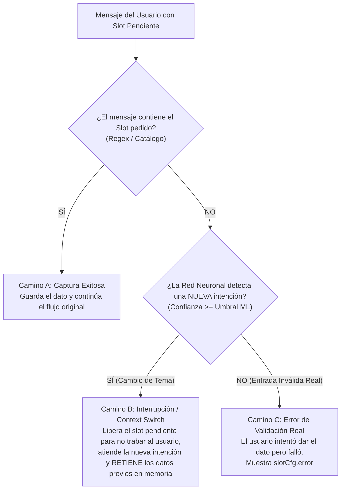

# 🤖 IaConia NLU Engine — Client-Side & In-Memory AI Library

[](https://www.npmjs.com/package/iaconia)
[](LICENSE)
[](https://www.typescriptlang.org/)
[](https://bundlephobia.com/package/iaconia)

> **IaConia** es un motor de **Inteligencia Artificial Conversacional (NLU)** y clasificación de intenciones ultraligero que funciona **100% en la memoria RAM** de tu aplicación. 
> 
> Responde en **menos de 2 milisegundos**, es 100% privado (no envía tus datos a servidores externos ni consume costos por token), no requiere GPUs y funciona tanto en **Node.js** como en navegadores web (**React, Vue, Vite, Next.js**) sin necesidad de conexión a internet.

---

## ⚡ Características Principales

- ⚡ **Baja latencia en turnos cortos:** Inferencia en memoria RAM, normalmente por debajo de 2 ms. Los textos largos pueden tardar mucho más: clasifica turno por turno.
- 📦 **Cero dependencias pesadas:** TF-IDF n-gramas + Regresión Logística Softmax + Distancia Levenshtein + Motor de Búsqueda Vectorial en TypeScript nativo.
- 🎯 **Preentrenado de fábrica:** Responde de inmediato saludos, soporte, despedidas y comandos sin necesidad de configuración previa.
- 🛡️ **Seguridad y Privacidad Absoluta:** Las intenciones y slots se procesan localmente en el dispositivo. Si requieres consultar APIs privadas o bases de datos externas, se delegan de forma segura mediante `onAction()`.
- 🔀 **Cambio de contexto en vivo:** Algoritmo de 3 vías con memoria retenida que no traba al usuario cuando cambia de tema.
- 🌐 **Control 100% Dinámico desde JSON:** Sin mensajes quemados en código; respuestas de respaldo, campos de base de datos y conectores gramaticales configurables desde JSON.
- 💾 **Portabilidad Total:** Serializa y restaura todo el cerebro del modelo con `exportModel()` y `loadModel()`.

---

## 🚀 Instalación

```bash
# Con NPM
npm install iaconia

# Con PNPM
pnpm add iaconia

# Con Yarn
yarn add iaconia
```

---

## 📖 Inicio Rápido en 3 Líneas

```typescript
import { IaConia } from 'iaconia';

// 1. Inicializa el motor conversacional en memoria
const bot = new IaConia();

// 2. Inferencia instantánea (< 2ms)
const respuesta = await bot.ask("¡Hola, buenas tardes!");

console.log(respuesta.reply);         // "¡Buen día! Un gusto saludarte. ¿Cómo te asisto?"
console.log(respuesta.intent);        // "saludo"
console.log(respuesta.confidencePct); // 99.4%
console.log(respuesta.latencyMs);     // 1.15ms
```

---

## 📑 Tabla de Contenidos

1. [Tabla de Métodos Disponibles](#-tabla-de-métodos-disponibles)
2. [1. Gestión de Neuronas (Intensiones del Usuario)](#-1-gestión-de-neuronas-intensiones-del-usuario)
3. [2. Extracción de Entidades y Variables (Slots)](#-2-las-4-formas-de-capturar-datos-los-slots)
4. [3. Conversaciones Fluidas y Manejo de Errores](#-3-conversaciones-fluidas-y-manejo-de-errores)
5. [4. Conectar a APIs Externas (`onAction`)](#-4-conectar-el-bot-a-apis-externas-onaction)
6. [5. Base de Datos Vectorial en Memoria (Búsqueda Léxica)](#-5-base-de-datos-vectorial-en-memoria-búsqueda-léxica)
7. [6. Objeto de Inferencia Enriquecido (`ResultadoInferencia`)](#-6-qué-información-te-devuelve-cada-mensaje)
8. [7. Guardar y Cargar el Cerebro del Bot (`exportModel` y `loadModel`)](#-7-guardar-y-cargar-el-cerebro-del-bot-exportmodel-y-loadmodel)
9. [8. Distribución de Probabilidades, Softmax y Detección de Ambigüedad](#-8-distribución-de-probabilidades-softmax-y-manejo-de-ambigüedad)
10. [9. Calibración y "Tuning" de Umbrales Matemáticos](#-9-calibración-y-tuning-de-umbrales-matemáticos)
11. [10. Cambio de Contexto en Vivo e Interrupción (Algoritmo de 3 Vías y Memoria Retenida)](#-10-cambio-de-contexto-en-vivo-e-interrupción-algoritmo-de-3-vías-y-memoria-retenida)
12. [11. Control 100% Dinámico desde JSON (Sin Reglas ni Mensajes Quemados)](#-11-control-100-dinámico-desde-json-sin-reglas-ni-mensajes-quemados)

---

## 📑 Tabla de Métodos Disponibles

Todos los métodos tienen nombres directos, limpios y consistentes en TypeScript/JavaScript:

| Método | ¿Para qué sirve? | Ejemplo rápido |
| :--- | :--- | :--- |
| **`bot.ask(mensaje, sessionId?)`** | Resuelve un turno conversacional completo: clasifica, valida slots, ejecuta acciones y retorna la respuesta. | `const res = await bot.ask("hola");` |
| **`bot.clasificar(texto)`** | Evalúa un texto y retorna la intención ganadora, su porcentaje de seguridad y el método (`ml`, `fuzzy`, etc.). | `const c = bot.clasificar("ver balance");` |
| **`bot.obtenerProbabilidades(texto, n?)`** | Retorna el ranking de certezas de la Red Neuronal (Softmax) ordenado de mayor a menor. | `const ranking = bot.obtenerProbabilidades("pizza", 4);` |
| **`bot.getNeuronas()`** | Te muestra la lista completa de todas las neuronas (intenciones) registradas. *(Alias: `getIntents()`)* | `bot.getNeuronas()` |
| **`bot.getNeurona(nombre)`**| Te da la información detallada de una neurona (sus expresiones y respuestas). | `bot.getNeurona("ayuda")` |
| **`bot.agregarNeurona(def)`**| Le enseña una nueva intención al bot con sus expresiones y respuestas. *(Alias: `addIntent()`)* | `bot.agregarNeurona({ intension: "...", expresiones: [...] })` |
| **`bot.actualizarNeurona(nombre, data)`**| Modifica las expresiones, respuestas o datos de una neurona existente. | `bot.actualizarNeurona("saludo", { respuestas: [...] })` |
| **`bot.eliminarNeurona(nombre)`**| Borra una neurona del bot y la reentrena. *(Alias: `removeIntent()`)* | `bot.eliminarNeurona("despedida")` |
| **`bot.agregarFrase(neurona, frase)`**| Le enseña una nueva forma de hablar al bot para una neurona. | `bot.agregarFrase("saludo", "qué tal amigo")` |
| **`bot.eliminarFrase(neurona, frase)`**| Quita una frase de ejemplo de una neurona. | `bot.eliminarFrase("saludo", "buenos días")` |
| **`bot.addSlot(nombre, config)`**| Le enseña al bot a reconocer un dato importante (nombre, teléfono, catálogo). *(Alias: `agregarSlot()`)* | `bot.addSlot("telefono", { tipo: "regex", regex: /\d{10}/ })` |
| **`bot.getSlots()`** | Muestra todos los tipos de datos (slots) que el bot sabe reconocer. | `bot.getSlots()` |
| **`bot.getSlot(nombre)`** | Muestra cómo está configurado un dato en particular. | `bot.getSlot("telefono")` |
| **`bot.eliminarSlot(nombre)`** | Borra un dato de la configuración del bot. | `bot.eliminarSlot("telefono")` |
| **`bot.extraerSlots(texto)`** | Lee un texto y te devuelve los datos encontrados sin avanzar el chat. | `bot.extraerSlots("mi cel es 5512345678")` |
| **`bot.buscarBaseDatos(query, n?)`** | Búsqueda léxica vectorial (TF-IDF y similitud coseno) en la base de datos interna. | `bot.buscarBaseDatos("jamon con piña", 2)` |
| **`bot.cargarBaseDatos(lista)`** | Carga o reemplaza el catálogo/documentos e indexa los vectores en memoria. *(Alias: `loadDatabase()`)* | `bot.cargarBaseDatos([...])` |
| **`bot.agregarRegistro(doc)`** | Agrega un producto o documento a la base de datos vectorial en caliente. *(Alias: `addRecord()`)* | `bot.agregarRegistro({ nombre: "..." })` |
| **`bot.getBaseDatos()`** | Retorna todos los documentos indexados en la base de datos. *(Alias: `getDatabase()`)* | `bot.getBaseDatos()` |
| **`bot.limpiarBaseDatos()`** | Vacía la memoria de la base de datos vectorial. *(Alias: `clearDatabase()`)* | `bot.limpiarBaseDatos()` |
| **`bot.onAction(accion, fn)`**| Conecta el bot a tu propia API externa, pasarela de pagos o lógica de negocio. | `bot.onAction("CONSULTAR_SALDO", async ({ slots }) => { ... })` |
| **`bot.getStats()`** | Te da métricas cuantitativas sobre la red neuronal en memoria. | `bot.getStats()` |
| **`bot.exportModel()`** | Exporta todo el cerebro del bot a un objeto `IaConiaConfig` serializable en camelCase. | `const backup = bot.exportModel();` |
| **`bot.loadModel(json)`** | Restaura el cerebro del bot desde un objeto o JSON guardado previamente. | `bot.loadModel(backup);` |

---

## 🧠 1. Gestión de Neuronas (Intensiones del Usuario)

Una **neurona** representa una **intensión** o propósito de la persona que habla con el bot (por ejemplo: saludar, consultar saldo, pedir una pizza, preguntar precios o despedirse).

### 📋 Anatomía y Atributos de una Neurona

| Atributo | Tipo | Requerido | Descripción | Ejemplo de Uso |
| :--- | :--- | :---: | :--- | :--- |
| **`intension`** | `string` | **Sí** | Identificador único de la intención o propósito (en minúsculas y snake_case). | `"consultar_saldo"` |
| **`expresiones`** | `string[]` | **Sí** | Frases de entrenamiento que dirá el usuario para activar esta neurona. | `["cuanto saldo tengo", "ver balance", "consultar saldo"]` |
| **`respuestas`** | `string[]` | Opcional | Mensajes que responderá el bot (soporta variables dinámicas `{slot.nombre}` o `{db.campo}`). Si hay varios, elige uno al azar. | `["Tu saldo disponible es de {db.saldo}."] ` |
| **`slots`** | `string[]` | Opcional | Nombres de las variables obligatorias que el bot debe recopilar antes de responder o ejecutar la acción. | `["numero_cuenta"]` |
| **`action`** | `string` | Opcional | Nombre del hook backend a ejecutar en `bot.onAction(...)` una vez recopilados los slots. | `"CONSULTAR_SALDO_API"` |
| **`sugerencias`** | `string[]` | Opcional | Botones interactivos o chips de opciones rápidas sugeridas al usuario. | `["Transferir", "Ver movimientos", "Recargar"]` |

#### Ejemplo completo con todos sus atributos:
```javascript
bot.agregarNeurona({
  intension: "consultar_saldo",
  expresiones: [
    "cuanto saldo tengo",
    "consultar mi saldo",
    "saldo disponible",
    "ver balance"
  ],
  respuestas: [
    "Tu saldo en la cuenta #{slot.numero_cuenta} es de {db.saldo}."
  ],
  slots: ["numero_cuenta"],
  action: "CONSULTAR_SALDO_API",
  sugerencias: [
    "Hacer una transferencia",
    "Ver últimos movimientos",
    "Recargar saldo"
  ]
});
```

### A. Ver todas las neuronas que conoce el bot
```javascript
const lista = bot.getNeuronas();
console.log(lista.map(n => n.intension));
// Resultado: ['saludo', 'despedida', 'agradecimiento', 'ayuda', 'consultar_estado', 'contactar_soporte']
```

### B. Ver los detalles de una neurona
```javascript
const neuronaAyuda = bot.getNeurona("ayuda");
console.log("Expresiones de ejemplo:", neuronaAyuda.expresiones);
console.log("Respuestas posibles:", neuronaAyuda.respuestas);
```

### C. Enseñarle una neurona nueva al bot
El bot la aprende al instante sin tener que reiniciar:
```javascript
bot.agregarNeurona({
  intension: "cotizar_servicio",
  expresiones: [
    "quiero una cotización",
    "cuánto me cobran por el servicio",
    "cuál es el precio de sus planes",
    "me interesa contratar"
  ],
  respuestas: [
    "¡Con gusto! Nuestros planes empiezan desde $299 USD al mes. ¿Te gustaría agendar una demostración?"
  ],
  sugerencias: ["Ver planes", "Agendar demo"]
});
```

### D. Enriquecer una neurona con nuevas formas de hablar
Si notas que los clientes usan una frase nueva que el bot no entendió, la agregas en una sola línea:
```javascript
bot.agregarFrase("saludo", "qué onda socio");
bot.agregarFrase("saludo", "buenas mi estimado");
```

Y si alguna frase ya no te gusta:
```javascript
bot.eliminarFrase("saludo", "qué onda socio");
```

### E. Eliminar una neurona que ya no necesitas
```javascript
bot.eliminarNeurona("despedida");
```

---

## 🎯 2. Las 4 Formas de Capturar Datos (Los "Slots")

### ¿Qué es un Slot?
Es simplemente **un dato importante que necesitas que la persona te dé** para poder atenderla bien (su nombre, su teléfono, el sabor de pizza o su dirección).

En **IaConia**, la configuración de slots ha sido **simplificada al máximo**, eliminando opciones redundantes y permitiéndote tener **control total con `regex`** o **atajos de 1 sola línea**:

```typescript
tipo: 'constante' | 'catalogo' | 'regex' | 'texto'
```

---

### 🚀 Atajos Limpios y Sintaxis Directa

Para los casos más comunes del día a día, dispones de sintaxis directa y concisa:

```javascript
// 1. Catálogo de opciones (nombre, opciones y pregunta)
bot.addSlot("pizza", ["pepperoni", "hawaiana", "mexicana"], "¿Qué especialidad deseas?");

// 2. Dato fijo del negocio (clave y valor constante)
bot.addSlot("empresa", "Pizzería Nápoles");

// 3. Extracción con Regex puro
bot.addSlot("telefono", {
  regex: /\b\d{10}\b/,
  pregunta: "¿A qué número de teléfono te contactamos?"
});

// 4. Texto libre con lista limpia de palabras a ignorar
bot.addSlot("nombre", {
  ignorar: ["me llamo", "mi nombre es", "soy", "hola", "buenas"],
  formato: "title",
  pregunta: "¿Cuál es tu nombre completo?"
});
```

---

### 1️⃣ Tipo `regex` (Control Total con Expresiones Regulares)
Para datos con un formato estructurado (teléfonos, códigos, DNI, RFC, correos). 

```javascript
// Acepta expresiones regulares nativas /.../ o cadenas de texto
bot.addSlot("telefono", {
  tipo: "regex",
  regex: /\b\d{10}\b/,
  pregunta: "¿Cuál es tu número de teléfono a 10 dígitos?",
  error: "⚠️ El teléfono ingresado no es válido. Debe contener exactamente 10 números (ej: 5512345678):"
});

// Código de paquete alfanumérico (con formato en mayúsculas)
bot.addSlot("codigo_paquete", {
  tipo: "regex",
  regex: /[a-zA-Z]{2}-?\d{6}/i,
  formato: "upper",
  pregunta: "¿Cuál es el código de tu paquete? (Ejemplo: MX-123456)",
  error: "⚠️ El código no cumple el formato. Debe ser de 2 letras y 6 números (ej: MX-123456):"
});
```

* **Comportamiento en vivo:**
  * Si el cliente escribe: *"hola mi cel es 5588991122 para el pedido"* 👉 Extrae exactamente `"5588991122"`.
  * Si el cliente escribe: *"mi cel es abcd123"* 👉 El bot responde con el mensaje de **`error`**:  
    `"⚠️ El teléfono ingresado no es válido. Debe contener exactamente 10 números..."`

---

### 2️⃣ Tipo `catalogo` (Lista de opciones con Fuzzy Matching)
Se usa cuando el dato pertenece a una **lista cerrada de opciones** (menús, servicios, sucursales). Perdona faltas de ortografía y palabras desordenadas.

```javascript
bot.addSlot("sabor_pizza", {
  tipo: "catalogo",
  opciones: ["pepperoni", "hawaiana", "cuatro quesos", "mexicana", "champiñones"],
  umbral: 65, // Tolerancia difusa (default: 65)
  pregunta: "¿De qué especialidad deseas tu pizza?",
  error: "Disculpa, no contamos con esa especialidad. Elige entre: pepperoni, hawaiana, cuatro quesos o mexicana:"
});
```

* **Comportamiento en vivo:**
  * *"quiero pedir una de peperoni"* 👉 Reconoce `"pepperoni"`.
  * *"quiero sushi"* 👉 Dispara el **`error`**: *"Disculpa, no contamos con esa especialidad..."*.

---

### 3️⃣ Tipo `texto` (Lenguaje abierto con lista `ignorar`)
Para capturar datos libres como nombres o direcciones. Durante una conversación solo se captura cuando el bot pidió ese dato, para que otras frases no lo sobrescriban. En lugar de complicarte con tres arrays distintos, tienes una sola lista limpia: **`ignorar`**:

```javascript
bot.addSlot("nombre_cliente", {
  tipo: "texto",
  ignorar: ["me llamo", "mi nombre es", "soy", "hola", "buenas", "por favor", "gracias"],
  formato: "title", // "carlos alberto" -> "Carlos Alberto"
  pregunta: "¿A nombre de quién registramos el pedido?",
  error: "No alcancé a capturar tu nombre. Por favor indícamelo de nuevo:"
});
```

* **Comportamiento en vivo:**
  * Si el cliente escribe: *"Hola buenas tardes, me llamo carlos alberto gomez"* 👉 Guarda: `"Carlos Alberto Gomez"`.
  * Si el cliente escribe: *"carlos alberto me llamo y soy de piura"* 👉 Extrae limpiamente el primer bloque continuo: `"Carlos Alberto"`.

---

### 4️⃣ Tipo `constante` (Datos fijos del negocio)
Datos fijos que nunca cambian y nunca se le preguntan al cliente:

```javascript
bot.addSlot("empresa", {
  tipo: "constante",
  valor: "Pizzería Nápoles"
});

bot.addSlot("telefono_soporte", {
  tipo: "constante",
  valor: "+52 55 1234 5678"
});
```

---

### 📋 Tabla Resumen de Configuración de Slots

| Propiedad | ¿En qué tipo se usa? | ¿Para qué sirve? (en lenguaje simple) | Ejemplo |
| :--- | :--- | :--- | :--- |
| **`pregunta`** | Todos | La pregunta que el bot formula si este dato hace falta. | `pregunta: "¿Cuál es tu teléfono?"` |
| **`error`** | `regex`, `catalogo`, `texto` | Mensaje de reintento si el usuario responde algo inválido (formato erróneo o producto no existente). | `error: "Ingresa 10 dígitos numéricos:"` |
| **`regex`** | `regex` | Expresión regular nativa (`/.../`) o en texto para extraer el dato. | `regex: /\\b\\d{10}\\b/` |
| **`grupo`** | `regex` | Índice del grupo de captura de la regex (default `1` si hay paréntesis, o `0`). | `grupo: 1` |
| **`opciones`** | `catalogo` | Lista de palabras válidas que el bot debe reconocer. | `["pizza", "hamburguesa"]` |
| **`umbral`** | `catalogo` | Tolerancia a errores ortográficos (0 a 100, default `65`). | `umbral: 65` |
| **`ignorar`** | `regex`, `texto` | Frases, muletillas o saludos que deben limpiarse o ignorarse. | `["me llamo", "soy", "hola"]` |
| **`formato`** | `regex`, `texto` | Cómo guardar el texto: `"title"` (Capitalizado), `"upper"` (MAYÚSCULAS) o `"lower"`. | `formato: "title"` |
| **`valor`** | `constante` | El dato fijo que el bot siempre tendrá listo. | `valor: "Wimprove Inc"` |

---

## 🔄 3. Conversaciones Fluidas y Manejo de Errores

Cuando un pedido o trámite necesita varios datos obligatorios (`slots`), el bot va solicitando amablemente lo que falte y validando cada respuesta:

```javascript
bot.agregarNeurona({
  intension: "pedir_comida",
  expresiones: ["quiero pedir una pizza", "hacer un pedido"],
  slots: ["nombre_cliente", "telefono"],
  respuestas: [
    "¡Perfecto {slot.nombre_cliente}! Registramos tu pedido con teléfono {slot.telefono}. 🍕"
  ],
  sugerencias: ["Ver mi pedido", "Cancelar"]
});
```

1. **Usuario:** *"Quiero pedir una pizza"*  
   👉 **Bot:** *"¿A nombre de quién registramos el pedido?"*

2. **Usuario:** *"claro mi nombre es carlos alberto me llamo y soy de piura"*  
   👉 **Bot:** *"¿Cuál es tu número de teléfono a 10 dígitos?"* *(Captura limpia de "Carlos Alberto")*

3. **Usuario:** *"mi telefono es abcd123"*  *(Respuesta inválida)*  
   👉 **Bot (Mensaje de error):** *"⚠️ El teléfono ingresado no es válido. Debe contener exactamente 10 números (ej: 5512345678):"*

4. **Usuario:** *"Olvídalo, mejor dime sus horarios"*  *(Interrupción / Cambio de Tema)*  
   👉 **Bot:** *"🕒 Abrimos de 12:00 PM a 10:00 PM."*  
   *(La IA detecta la nueva intención con su Red Neuronal, libera el slot pendiente para no trabar al usuario, y retiene `nombre_cliente: Carlos Alberto` en memoria).*

5. **Usuario:** *"Ok, sigamos con mi pedido"*  *(Retoma el trámite con Memoria Retenida)*  
   👉 **Bot:** *"¿Cuál es tu número de teléfono a 10 dígitos?"*  
   *(Recuerda el nombre y solo pide el dato que faltaba).*

6. **Usuario:** *"mi cel es 5512345678"*  *(Respuesta válida)*  
   👉 **Bot:** *"¡Perfecto Carlos Alberto! Registramos tu pedido con teléfono 5512345678. 🍕"*

---

## ⚡ 4. Conectar el Bot a APIs Externas (`onAction`)

Si necesitas consultar un clima real, consultar un saldo en tu banco o verificar un pedido en MySQL, usa **`onAction`**:

### Opción A: Usar plantillas con `{api.campo}` o `{datos.campo}`
```javascript
// 1. Declaramos la neurona y su acción
bot.agregarNeurona({
  intension: "consultar_clima",
  expresiones: ["cuál es el clima", "cómo está el tiempo en"],
  slots: ["ciudad"],
  action: "CONSULTAR_CLIMA_API",
  respuestas: [
    "🌤️ En {slot.ciudad} la temperatura es de **{api.temperatura}** con cielo **{api.condicion}**."
  ],
  sugerencias: ["Ver pronóstico semanal", "Cambiar de ciudad"]
});

bot.addSlot("ciudad", {
  tipo: "catalogo",
  opciones: ["madrid", "bogota", "ciudad de mexico", "buenos aires", "lima"],
  pregunta: "¿De qué ciudad deseas consultar el pronóstico?",
  error: "Disculpa, solo tenemos pronósticos para: Madrid, Bogotá, CDMX, Buenos Aires o Lima."
});

// 2. Conectamos la acción y retornamos { api: { ... } } o { datos: { ... } }:
bot.onAction("CONSULTAR_CLIMA_API", async ({ slots }) => {
  const res = await fetch(`https://api.clima.com?ciudad=${slots.ciudad}`);
  const info = await res.json();
  
  return {
    api: {
      temperatura: info.temperatura + "°C",
      condicion: info.cielo
    }
  };
});
```

### Opción B: Construir el texto directamente en código (`reply`)
Si la respuesta depende de condiciones (ej: si la API falló o el pedido no existe), puedes armar tú mismo el mensaje sin usar etiquetas:

```javascript
bot.onAction("CONSULTAR_PEDIDO_API", async ({ slots }) => {
  const res = await fetch(`https://api.tienda.com/pedidos/${slots.codigo}`);
  
  if (!res.ok) {
    return {
      reply: `❌ No existe ningún pedido con el código **${slots.codigo}**.`
    };
  }

  const pedido = await res.json();
  return {
    reply: `📦 Tu pedido de **${pedido.producto}** está **${pedido.estado}**.`
  };
});
```

> **📌 Diferencia entre `{api}` y `{db}`:**
> * **`{api.campo}` / `{datos.campo}`**: Datos vivos que provienen de una **API externa o Backend** ejecutado por un `action`.
> * **`{db.campo}`**: Datos fácticos que provienen de la **Base de Datos Vectorial interna** del bot (los productos indexados en memoria).

---

## 🗄️ 5. Base de Datos Vectorial en Memoria (Búsqueda Léxica)

**IaConia** incluye un **motor de recuperación vectorial ultraligero que corre 100% en la memoria RAM** de tu aplicación. 

A diferencia de las bases de datos vectoriales tradicionales en la nube (como Pinecone, ChromaDB o Qdrant) que requieren conexión a internet y añaden cientos de milisegundos de latencia, el motor vectorial de IaConia:
* Convierte cualquier lista de objetos JSON a vectores matemáticos dispersos (**TF-IDF + Cosine Similarity**).
* Aplica **lematización morfológica en español** (reduce plurales y elimina tildes; no reconoce sinónimos).
* Compara palabras, no significado: la consulta debe compartir términos con el documento. No genera texto.

---

### A. Cargar un Catálogo o Base de Documentos

Puedes cargar cualquier colección de objetos JSON al instanciar el bot o en cualquier momento con `bot.cargarBaseDatos`:

```javascript
bot.cargarBaseDatos([
  {
    id: 101,
    nombre: "Pizza Pepperoni Suprema",
    categoria: "pizzas",
    precio: "$180 MXN",
    descripcion: "Doble porción de pepperoni americano crocante con queso mozzarella fundido."
  },
  {
    id: 102,
    nombre: "Pizza Hawaiana Especial",
    categoria: "pizzas",
    precio: "$165 MXN",
    descripcion: "Jamón horneado de pierna, trozos de piña caramelizada y extra queso."
  },
  {
    id: 103,
    nombre: "Pizza Mexicana Picante",
    categoria: "pizzas",
    precio: "$190 MXN",
    descripcion: "Carne molida sazonada, jalapeños en rodajas, chorizo y frijoles refritos."
  }
]);
```

---

### B. Búsqueda Léxica Directa (Por Palabras)

Puedes consultar la base de datos vectorial directamente en tu código. El motor encontrará el registro que comparta palabras con la consulta, **aunque el usuario no diga el nombre exacto**:

```javascript
// El usuario nunca dijo "hawaiana", pero menciona un ingrediente que aparece en el registro:
const resultados = bot.buscarBaseDatos("quiero algo con jamon", 1);

console.log(resultados[0].nombre); // "Pizza Hawaiana Especial"
console.log(resultados[0].precio); // "$165 MXN"
```

---

### C. Consultar la Base de Datos con `action` (100% Dinámico)

Para consultar la base de datos dentro de una conversación sin depender de nombres de variables estáticos o fijos, conectas la neurona a un **`action`**. En la acción recibes la función **`buscarBaseDatos`** lista para usar:

```javascript
// 1. Declaras la neurona con su acción y plantilla:
bot.agregarNeurona({
  intension: "consultar_producto",
  expresiones: [
    "cuanto cuesta la pizza",
    "que precio tiene la",
    "de que esta hecha la",
    "que ingredientes tiene la"
  ],
  action: "BUSCAR_PRODUCTO_DB",
  respuestas: [
    "🍕 La **{db.nombre}** cuesta **{db.precio}**.\nIngredientes: {db.descripcion}"
  ],
  sugerencias: ["Pedir ahora", "Ver otras opciones"]
});

// 2. En la acción decides exactamente qué buscar (ej: el mensaje o un slot):
bot.onAction("BUSCAR_PRODUCTO_DB", async ({ mensaje, buscarBaseDatos }) => {
  const [producto] = buscarBaseDatos(mensaje, 1);
  return { db: producto };
});
```

#### Flujo en tiempo real:
1. **Usuario:** *"Oye, ¿cuánto cuesta la mexicana y qué lleva?"*
2. **Acción:** `BUSCAR_PRODUCTO_DB` ejecuta `buscarBaseDatos(mensaje)` en microsegundos y encuentra la *Pizza Mexicana Picante*.
3. **Respuesta del Bot (< 2ms):**  
   👉 *"🍕 La **Pizza Mexicana Picante** cuesta **$190 MXN**.\nIngredientes: Carne molida sazonada, jalapeños en rodajas, chorizo y frijoles refritos."*

---

### D. Agregar Registros en Caliente

Si tu aplicación añade un producto nuevo mientras está corriendo, puedes agregarlo al instante:

```javascript
bot.agregarRegistro({
  id: 104,
  nombre: "Brownie con Helado",
  categoria: "postres",
  precio: "$65 MXN",
  descripcion: "Pastelillo de chocolate tibio con una bola de helado de vainilla."
});

// Queda indexado vectorialmente en memoria de inmediato:
const postres = bot.buscarBaseDatos("postre de chocolate", 1);
console.log(postres[0].nombre); // "Brownie con Helado"
```

---

## 📦 6. ¿Qué información te devuelve cada mensaje?

Cuando ejecutas:
```javascript
const res = await bot.ask("hola, quiero una pizza hawaiana");
```

Recibes un objeto de inferencia enriquecido y tipado (`ResultadoInferencia`):
```javascript
console.log(res);
// {
//   reply: "¡Excelente elección! ¿A qué número de teléfono te contactamos?",
//   messages: ["¡Excelente elección! ¿A qué número de teléfono te contactamos?"],
//   intent: "hacer_pedido",        // Intención detectada por el modelo
//   confidencePct: 98.2,           // Porcentaje de seguridad legible (0% a 100%)
//   confidence: 0.982,             // Puntuación matemática (0.0 a 1.0)
//   method: "ml",                  // Método usado: 'ml' | 'ml-ngram' | 'fuzzy' | 'direct-slot' | 'ninguno'
//   slots: {                       // Datos limpios y estructurados reunidos en la sesión
//     pizza: "hawaiana"
//   },
//   slotsRequeridos: ["telefono"], // Lista de variables que aún faltan para completar la neurona
//   action: null,                  // Acción backend ejecutada (si la neurona tenía una asociada)
//   latencyMs: 1.15,               // Latencia de inferencia en milisegundos (< 2ms)
//   sessionId: "default",          // ID de sesión del usuario
//   sugerencias: [                 // Chips interactivos sugeridos por la neurona para la UI
//     "Ver bebidas", 
//     "Cancelar"
//   ],
//   probabilities: [               // Ranking Softmax completo de todas las neuronas
//     { intent: "hacer_pedido", probability: 0.982 },
//     { intent: "consultar_menu", probability: 0.015 }
//   ]
// }
```

---

## 💾 7. Guardar y Cargar el Cerebro del Bot (`exportModel` y `loadModel`)

Si configuraste neuronas, slots, umbrales o registros en la base de datos y deseas guardarlos en un archivo JSON o en tu base de datos (PostgreSQL, MongoDB, Redis, etc.):

```javascript
// 1. Exportar todo a un objeto JSON serializable en camelCase (con 50 intenciones y 600 frases: ~27 KB sin pesos, ~850 KB con pesos; usa `exportModel({ incluirPesos: false })` para omitirlos):
const cerebro = bot.exportModel();
const jsonString = JSON.stringify(cerebro, null, 2);

// Estructura exportada (IaConiaConfig):
// - nombre: Nombre del bot
// - baseConocimiento: Todas las neuronas, expresiones y respuestas
// - esquemaSlots: Slots declarados (con RegExp serializadas de forma segura)
// - baseDatos: Todos los documentos indexados en el motor vectorial
// - pesosEntrenados: Vocabulario y pesos para restaurar sin reentrenar
// - umbralClasificacion y umbralFuzzy: Valores de calibración matemática
// - mensajesPorDefecto, camposIgnoradosDb, conectoresTexto: Reglas dinámicas globales

// 2. En cualquier otro servidor, API o frontend (React/Vue), cargarlo al instante:
const nuevoBot = new IaConia();
nuevoBot.loadModel(JSON.parse(jsonString)); 
// ✅ Restaura los pesos guardados y reindexa; solo reentrena si cambiaron las frases
```

---

## 📊 8. Distribución de Probabilidades, Softmax y Manejo de Ambigüedad

IaConia calcula las probabilidades de todas las neuronas mediante una regresión logística multinomial normalizada con la función matemática **Softmax** (donde todas las probabilidades suman exactamente 1.0 / 100%).

### A. Consultar el ranking completo de certezas
```javascript
const ranking = bot.obtenerProbabilidades("quiero ordenar comida", 4);
console.log(ranking);
// [
//   { intent: "hacer_pedido", probability: 0.945 },
//   { intent: "consultar_menu", probability: 0.041 },
//   { intent: "cancelar_pedido", probability: 0.008 },
//   { intent: "soporte_humano", probability: 0.006 }
// ]
```

### B. Detección Matemática de Ambigüedad ($\Delta = P_1 - P_2 < 0.15$)
Cuando el usuario envía una frase ambigua o mixta (ej: *"pedir o cancelar"*), dos intenciones pueden competir muy de cerca:
* Neurona 1 (`cancelar_pedido`): `46.0%`
* Neurona 2 (`hacer_pedido`): `38.8%`
* **Diferencia ($\Delta$):** `7.2%` (menor a 15%)

```javascript
const [top1, top2] = bot.obtenerProbabilidades(mensaje, 2);
const delta = top1.probability - top2.probability;

if (delta < 0.15) {
  // ⚠️ Ambigüedad detectada: En vez de adivinar a ciegas, ofrece opciones de desempate
  console.log("Duda entre:", top1.intent, "y", top2.intent);
  // Usa res.sugerencias para mostrar botones interactivos al usuario
}
```

---

## 🎛️ 9. Calibración y "Tuning" de Umbrales Matemáticos

IaConia cuenta con dos perillas de control para ajustar la sensibilidad del motor según el tipo de aplicación:

```typescript
const bot = new IaConia({
  umbralClasificacion: 0.70, // Fase 1: Red Neuronal (0.0 a 1.0 | default: 0.45)
  umbralFuzzy: 85            // Fase 2: Corrector Difuso Levenshtein (0 a 100 | default: 76)
});

// O cambiarlos en caliente en cualquier momento:
bot.umbralClasificacion = 0.50;
bot.umbralFuzzy = 78;
```

### Matriz de Calibración Recomendada por Industria:

| Perfil de Aplicación | `umbralClasificacion` | `umbralFuzzy` | Filosofía y Comportamiento |
| :--- | :---: | :---: | :--- |
| 🏦 **Fintech / Banca / Salud / Legal** | `0.70` | `88` | **Cero tolerancia al error:** Exige frases claras y palabras clave inequívocas. Rechaza antes de adivinar o arriesgar una transacción errónea. |
| 🍕 **E-Commerce / Delivery / Pizzería** | `0.48` | `76` | **Balance comercial:** Rápido, certero y amigable. Perdona errores ortográficos comunes sin trabar la venta. |
| 🎮 **Videojuegos / Entretenimiento / Soporte Informal** | `0.35` | `68` | **Máxima simpatía:** Responde a casi todo, tolera modismos y jerga sin frustrar al usuario. |

---

## 🔀 10. Cambio de Contexto en Vivo e Interrupción (Algoritmo de 3 Vías y Memoria Retenida)

A diferencia de los bots basados en árboles rígidos que atrapan al usuario cuando un dato no es válido, IaConia implementa un **algoritmo de decisión de 3 vías con Estrategia B (Memoria Retenida)**:



### Ejemplo de Conversación con Interrupción y Memoria Retenida:
1. **Usuario:** *"Hola, quiero pedir una pizza hawaiana"*  
   👉 **Bot:** *"¿A qué número de teléfono a 10 dígitos te contactamos?"* *(Captura `pizza: hawaiana`, pide `telefono`).*
2. **Usuario:** *"mi cel es 123"* *(Camino C: Error real de formato).*  
   👉 **Bot:** *"⚠️ El teléfono ingresado no es válido. Debe contener exactamente 10 dígitos..."*
3. **Usuario:** *"Olvídalo, mejor dime sus horarios de atención"* *(Camino B: Interrupción en vivo).*  
   👉 **Bot:** *"🕒 Nuestro horario de atención es de Lunes a Domingo de 12:00 PM a 10:00 PM."*  
   *(La IA detecta la interrupción, libera el slot pendiente para no trabar al cliente, y retiene `pizza: hawaiana` en memoria).*
4. **Usuario:** *"Ok, sigamos con mi pedido"* *(Estrategia B: Retomar con memoria).*  
   👉 **Bot:** *"¿A qué número de teléfono a 10 dígitos te contactamos?"*  
   *(Recuerda que la pizza era hawaiana y va directo al dato que faltaba).*
5. **Usuario:** *"Es 5512345678"* *(Camino A: Captura exitosa).*  
   👉 **Bot:** *"🍕 ¡Listo! Tu pizza **hawaiana** ha sido ordenada con éxito. Te llamaremos al **5512345678**."*

---

## 🌐 11. Control 100% Dinámico desde JSON (Sin Reglas ni Mensajes Quemados)

Para que **IaConia** sea una librería completamente agnóstica de idioma y dominio, toda respuesta de respaldo, regla de indexación y filtro gramatical se puede controlar y personalizar directamente desde la configuración JSON:

```typescript
const bot = new IaConia({
  nombre: "Global Travel Assistant",

  // 1. Plantillas y Mensajes de Respaldo Globales
  mensajesPorDefecto: {
    // Se dispara cuando ninguna neurona supera los umbrales de certeza
    noEntendido: "I am sorry, I could not understand your request. Could you please rephrase?",

    // Plantilla para solicitar un dato faltante (soporta el tag {slot})
    solicitarSlot: "Please tell me: what is your {slot}?",

    // Mensaje cuando la neurona se procesó pero no tiene respuestas[] explícitas (soporta {intencion})
    intencionProcesada: "Success! Your request for **{intencion}** has been processed."
  },

  // 2. Campos Ignorados en Base de Datos Vectorial
  // Evita que campos autoincrementales o códigos internos generen ruido en la búsqueda
  camposIgnoradosDb: ["id", "_id", "created_at", "internal_code"],

  // 3. Conectores Gramaticales para Extracción de Texto Libre
  // Limpia conectores sueltos al final de una frase (ej: "London and" -> "London")
  conectoresTexto: ["and", "or", "to", "with", "for"],

  baseConocimiento: [...],
  esquemaSlots: {...}
});
```

### Atributos Dinámicos de `IaConiaConfig`:

| Clave JSON | Tipo | Valor por Defecto | Propósito |
| :--- | :--- | :--- | :--- |
| **`mensajesPorDefecto.noEntendido`** | `string` | `"Disculpa, no logré comprender tu mensaje..."` | Mensaje emitido cuando la IA rechaza el texto por baja confianza o fuera de dominio. |
| **`mensajesPorDefecto.solicitarSlot`** | `string` | `"Por favor, indícame el valor para {slot}."` | Pregunta genérica de aclaración si el slot no tiene `pregunta` personalizada. |
| **`mensajesPorDefecto.intencionProcesada`** | `string` | `"He procesado tu solicitud de **{intencion}**."` | Respuesta emitida si una neurona no tiene `respuestas: []` definidas. |
| **`camposIgnoradosDb`** | `string[]` | `["id", "_id", "fecha_creacion", "created_at"]` | Claves JSON que el vectorizador omite para no indexar basura numérica. |
| **`conectoresTexto`** | `string[]` | `["y", "e", "o", "u", "de", "del", "en", "con", ...]` | Conectores gramaticales a recortar al final de campos de texto libre. |
| **`ejemplosFueraDominio`** | `string[]` | `[]` | Frases que el bot debe rechazar, como negaciones o temas ajenos a tu negocio. |
| **`coberturaMinima`** | `number` | `0.34` | Porción mínima de palabras con contenido que el modelo debe conocer. `0` desactiva el filtro. Valores altos rechazan más frases válidas; calíbralo con tus datos. |
| **`palabrasVacias`** | `string[]` | Lista en español | Palabras excluidas del cálculo de cobertura. Reemplázala si tu bot usa otro idioma. |

> **💡 Portabilidad Total:** Todos estos campos se incluyen automáticamente al invocar `bot.exportModel()` y se restauran al llamar `bot.loadModel(json)`.

---

## 📄 Licencia

MIT License © 2026 IaConia AI Team.
Libre para uso comercial y personal.
